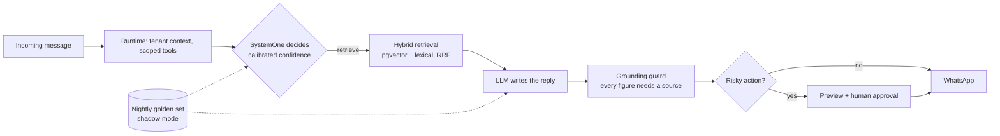

### Guilherme Peixoto

AI Engineer and economist (IBMEC). I founded **[Elpis](https://elpiscrm.com)**, an AI-native CRM for real estate brokerages integrated with WhatsApp, and I am its only engineer: architecture, AI systems, platform and operations. It has been in production since July 2026, in a closed beta with brokers and more than 6,000 leads. The product code is private; this profile holds the open pieces.

**What I work on**

- **Hybrid decision systems.** A non-generative model with calibrated confidence (TypeSafe SystemOne) makes the calls where deciding is the job (triage, reranking, gating, lead qualification), and LLMs only write. Every new decision ships off, then in shadow mode, and acts only after its agreement is measured.
- **Evaluation-driven development.** Golden sets, LLM-as-judge and regression gates before anything ships. In Elpis this cut fabricated figures from 10–18 to 0–1 per 20 questions and raised assistant accuracy from 37% to 84%.
- **Agent systems.** Tool-calling agents with scoped tools and permissions, tenant context injected by the runtime (never by the model), human-in-the-loop for risky actions, and an MCP server with OAuth 2.1 that connects ChatGPT and Claude to a user's account.
- **AI-native engineering.** I build with a team of coding agents that I direct (parallel agents, specialist reviewers, hooks), with project knowledge in an Obsidian second brain and every change verified before merge.

**How a message flows in Elpis**

**Open projects**

| Project | What it shows |
| --- | --- |
| [eval-dataset-generator](https://github.com/Guilherme-pxt/eval-dataset-generator) | Turns production LLM logs into a reviewed eval set, scores model versions and blocks regressions in CI. Runs offline on local models. |
| [hybrid-search-rag](https://github.com/Guilherme-pxt/hybrid-search-rag) | BM25, vector search, RRF fusion and a local LLM reranker, with a citation verifier and a measured ablation on near-duplicate documents. Reranking lifts Recall@1 from 0.56 to 0.90; a non-generative model (TypeSafe Jev) matches the LLM reranker at 0.25 s instead of 6.7 s per question, for US$0.02 in total. Fusion alone did not help, and the report says so. |
| [text-to-sql-guardrails](https://github.com/Guilherme-pxt/text-to-sql-guardrails) | A local LLM writes SQL; deterministic guards and Jev decide whether it runs, asks for confirmation or is refused. Guards take unsafe executions from 11 to 0 at no cost in accuracy; Jev raises clarification on ambiguous questions from 70% to 95%, while an LLM judge doing the same job scores worse than no judge. |

More on the way: agent orchestration with human approval.

**Stack:** Python, Node.js, TypeScript, PostgreSQL and pgvector, React, Docker, Prometheus and Grafana, Claude, Gemini, SystemOne, MCP, Apple MLX.

**Contact:** [LinkedIn](https://www.linkedin.com/in/guilhermelucenapeixoto) · Rio de Janeiro, Brazil (UTC−3), open to remote roles.
